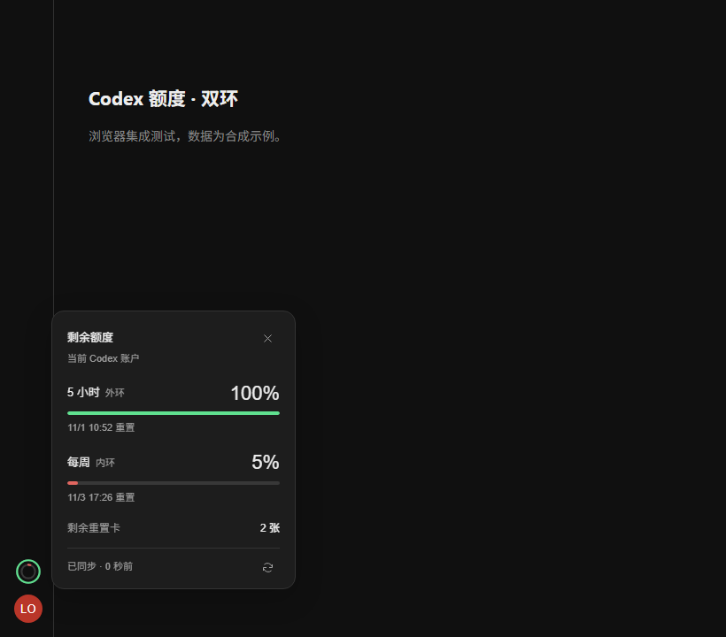

# Codex Quota Rings

[简体中文](README.md) · Windows x64 · MIT · Unofficial

Two compact quota rings above your Codex Desktop profile avatar. The outer ring shows **5-hour capacity remaining**; the inner ring shows **weekly capacity remaining**. Each ring changes continuously from green at full capacity through yellow and orange to red at 10% or less. Hover for percentages, reset times and the available **reset-card count**. Click to pin the panel; click again or press Escape to close it.

Version 0.1.5 fixes the old adapter-unavailable state by preferring the desktop message bridge, retaining a legacy fallback, and removing the React root dependency for bridge-based mounting. Compatibility is capability-based, not a desktop-version allowlist. Future internal bridge or layout changes may still require an extension update.

[Download installer](https://github.com/ITLOSERZzz/codex-quota-rings/releases/latest) · [Report an issue](https://github.com/ITLOSERZzz/codex-quota-rings/issues)



## Install

1. Download the complete `CodexQuotaRings-VERSION-win-x64.zip` from GitHub Releases and extract it.
2. Double-click `Install.cmd`. It registers one per-user, on-demand Windows launch task, with no login, boot or timed triggers. No administrator access or separate Node.js installation is required.
3. Open the **Codex 额度** desktop shortcut. If Codex is already running, the launcher waits in the background; save your work and use **the system-tray Quit command** to fully quit. The waiting launcher then reopens it once automatically.

The dedicated shortcut enables a loopback-only debugging endpoint needed for the native mount. The extension never force-quits Codex or patches its signed installation. Launching Codex from its original shortcut does not enable this mount.

Closing a window may leave background processes running. Waiting lasts up to 30 minutes, duplicate launchers are excluded, and upgrade/uninstall cancels the pending launch. `Check.cmd` in the installed directory prints sanitized startup and mount status.

Version 0.1.4 retains the original main-process handles and detects their exit without requiring every worker to disappear or an extra empty-process interval. A competing ordinary relaunch is reported explicitly and is never terminated by the add-on.

Files are installed under `%LOCALAPPDATA%\Programs\CodexQuotaRings`. To uninstall, run `Uninstall.cmd` there. Only owned files and the owned shortcut are removed; user-added files survive.

The 0.1.3 candidate starts the launcher through Task Scheduler so it does not rely on the initiating Codex/command runner's process lifetime. The action stays alive with its quota helper and exits when monitoring ends. Uninstall validates and removes the owned task. **Registration, limited privilege, service-parented execution and continuing heartbeat have been checked on the current Windows account. Native mounting, quota windows and reset-card availability have been verified in a real test instance. The user also confirmed shortcut-based mounting after reboot.**

State is stored under `%USERPROFILE%\.codex-quota-rings`, separate from the official `.codex` directory, to avoid divergent AppData views between packaged and standalone processes. Old AppData state is no longer used.

## Standard plugin and native mount

This repository contains an optional **standard Codex MCP plugin** and a **native desktop mount**. Public sidebar entrypoints open plugin panels; they do not support inserting dynamic rings above the avatar. Installing the MCP plugin alone therefore does not install the rings. The complete Windows Release is the recommended installation.

Navigation-rail layout was informed by [Lorie7813/codex-usage-card](https://github.com/Lorie7813/codex-usage-card). Its original-icon automatic startup uses a macOS background helper and guarded relaunch. That startup behavior has **not** been ported to this Windows package; see [implementation research](REFERENCE-RESEARCH.md).

After publishing this repository, the optional plugin can be installed using:

```text
codex plugin marketplace add ITLOSERZzz/codex-quota-rings
codex plugin add quota-rings@codex-quota-rings
```

Git-based MCP installation requires Node.js 22.5+ on PATH. The Windows release includes its own Node runtime. The plugin exposes read-only status and installation guidance tools. It never installs software or restarts Codex automatically.

## Data correctness

Production data comes from the **current desktop renderer's own local account client**, using only `account/read` and `account/rateLimits/read`. Account identity is checked before and after every quota read and kept in memory only. No credential files, cookies, session logs, prompts or responses are read. A separate CLI account is never used for the displayed production quotas.

Only the general `codex` bucket is used. Windows are identified by their actual duration (300/10080 minutes), not their primary/secondary position. Missing or expired windows remain unknown. Reset cards use only the authoritative `availableCount`; zero and unavailable are distinct.

Reads run every 15 seconds, plus hover refresh when at least five seconds have elapsed. The panel shows the last successful update. Failed or stale reads are not shown as current percentages. A reset countdown reaching zero never fabricates 100% capacity. Upstream reporting latency still applies.

## Compatibility and validation

The initial adapter targets Windows x64 and Chinese/English profile-menu labels. It was checked against local desktop resources for `26.1027.3384.0`. Official read-only protocol responses have been validated with a real authenticated account. Rendering, account switching, disconnects, missing windows and installer behavior have automated synthetic integration tests.

Version 0.1.5 has been verified in a real Windows Codex Desktop 26.1027.3384.0 window: native sidebar mounting, both quota windows, reset-card retrieval and ongoing refresh. Windows 10, other desktop builds and all locales have not been individually tested. This is an unofficial preview; future internal message or layout changes can require an update.

## Develop and publish

No npm dependencies. Use Windows, Node.js 22.5+, and Chrome or Edge:

```text
node scripts/check.mjs
node --test tests/*.test.mjs
node tests/browser.mjs
powershell.exe -NoProfile -ExecutionPolicy Bypass -File tests/installer.ps1
powershell.exe -NoProfile -ExecutionPolicy Bypass -File tests/installer-messages.ps1
powershell.exe -NoProfile -ExecutionPolicy Bypass -File tests/launcher.ps1
powershell.exe -NoProfile -ExecutionPolicy Bypass -File tests/task-runner.ps1
powershell.exe -NoProfile -ExecutionPolicy Bypass -File tests/process-exit.ps1
```

Build the runtime-inclusive release using **Node.js v24.16.0 win-x64**:

```text
powershell.exe -NoProfile -ExecutionPolicy Bypass -File scripts/build-release.ps1
```

Upload this directory as the repository root, including hidden plugin/marketplace/workflow files. Do not commit runtime binaries, build artifacts or state. The included workflow checks pushes and PRs and builds a GitHub Release on a version tag matching `package.json`. Its first run in the published repository remains to be validated. You can also manually upload the ZIP and SHA-256 file to Releases.

See [SECURITY.md](SECURITY.md), [THIRD_PARTY_NOTICES.md](THIRD_PARTY_NOTICES.md), and [the official protocol](https://learn.chatgpt.com/docs/app-server).
