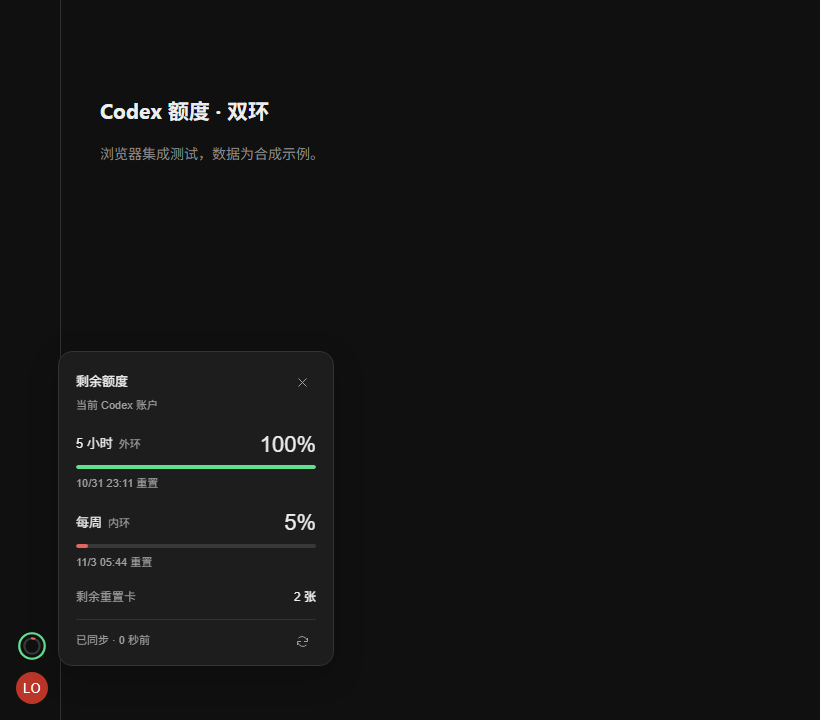

# Codex Quota Rings · Codex 额度双环

[English](README.en.md) · Windows x64 · MIT · 非官方扩展

[下载安装包](https://github.com/ITLOSERZzz/codex-quota-rings/releases/latest) · [反馈问题](https://github.com/ITLOSERZzz/codex-quota-rings/issues)

在 Codex Desktop 左下角、头像上方常驻两个小圆环：外环显示 **5 小时剩余额度**，内环显示 **每周剩余额度**。鼠标悬停查看百分比、重置时间与剩余重置卡；单击可固定面板，再次单击或按 Esc 收起。

两环分别按各自的余量平滑变色：满额为绿，约 50% 为黄，约 20% 为橙，不超过 10% 为红。0% 显示空环与红点；未知值显示灰色空环，绝不当作 0%。



<details><summary>查看实际组件的悬停效果（浏览器演示数据，非个人账户截图）</summary>


</details>

`0.1.5` 修复了圆环出现但提示“当前版本暂不兼容”的读取问题：优先使用桌面消息接口，保留旧客户端回退，不再依赖 React 内部入口名称。通过能力检测适配，不按 Codex 版本号拦截；未来若官方更改内部接口或侧栏结构，仍可能需要更新扩展。

## 普通用户：下载、双击安装

1. 在此仓库 **Releases** 下载 `CodexQuotaRings-版本号-win-x64.zip`，完整解压。
2. 双击 `Install.cmd`。安装器会注册一个**当前用户、按需运行**的 Windows 启动任务，不设开机、登录或定时触发；不需要管理员权限，不需要另装 Node.js。
3. 打开桌面的 **Codex 额度** 快捷方式。若 Codex 正在运行，启动器会在后台等待；请保存工作，再通过 **右下角托盘图标右键 → 退出/Quit** 完全退出。启动器会自动重开，无需再次点击。

以后使用这个快捷方式启动 Codex，双环会自动挂载。程序不会强制退出或重启正在运行的 Codex。**关闭窗口可能仍保留后台进程，请从右下角托盘图标的右键菜单选择退出/Quit。**等待退出最长 30 分钟；重复点击不会增加等待进程，安装、升级和卸载会取消本扩展的等待。从原始 Codex 图标启动时，不会启用双环所需的本机调试端口。

安装位置：`%LOCALAPPDATA%\Programs\CodexQuotaRings`。状态文件：`%USERPROFILE%\.codex-quota-rings`，与官方 `.codex` 目录分开；这里避开了打包应用与独立任务之间的 AppData 路径隔离。旧版 AppData 状态记录不再使用。安装目录的 `Check.cmd` 显示启动阶段、启动进程是否仍在、按需任务、监控与挂载状态，不打印账户、额度、窗口标题或原始日志。不改写 WindowsApps、`app.asar`、Codex 认证文件、聊天或模型配置。

卸载：在上述安装目录双击 `Uninstall.cmd`。卸载只删除本扩展拥有的文件及快捷方式；自己添加的文件会保留。更新时下载新版本，退出扩展后运行新版 `Install.cmd`。

## 它是标准插件吗？

这个仓库同时提供两部分：

- **本机界面扩展**：通过仅限本机的 CDP 将双环挂到现有桌面界面中，提供真正常驻的显示。这是非官方界面适配，需要专用启动快捷方式。
- **标准 Codex 插件**：包含 `.codex-plugin/plugin.json`、MCP 服务和 marketplace。安装后可以在聊天中读取双环状态、查看安装方式。它不会自行重启应用或安装挂载程序。

标准插件的公开 sidebar entrypoint 是打开面板的入口，不能直接向头像上方插入动态双环。因此，只安装 MCP 插件并不会让常驻双环出现。普通用户选择上面的 Windows Release 即可，标准插件为可选项。

本版本参考 [Lorie7813/codex-usage-card](https://github.com/Lorie7813/codex-usage-card) 的侧栏布局做法，在原生 `nav[data-app-navigation-rail]` 中给双环建立独立位置。它的 macOS 版通过后台监听与受限的一次正常重开支持原图标启动；这部分 **尚未移植到本项目的 Windows 版本**。本版仍需上述快捷方式，不承诺原图标自动加载。见 [实现研究](REFERENCE-RESEARCH.md)。

开发者可执行以下命令安装可选插件：

```text
codex plugin marketplace add ITLOSERZzz/codex-quota-rings
codex plugin add quota-rings@codex-quota-rings
```

直接从 Git 仓库安装标准插件时，需要 Node.js 22.5+ 在 PATH 中；完整 Windows Release 自带 Node.js 运行时。重启应用后在聊天中请求“查看双环额度状态”。

## 数据如何保证可信

- 双环通过**当前 Codex 桌面窗口自己的本机请求客户端**调用 `account/read` 与 `account/rateLimits/read`。不读取另一套 CLI 登录作为生产数据源，不访问 `auth.json`、浏览器 Cookie、会话日志或对话正文。
- 读取额度前后核对账户身份。账户发生变化时立即丢弃这一轮结果，下一轮重新读取；账户身份仅在窗口内存里比较，不写入磁盘或日志。
- 只选择 `codex` 通用额度池，按 `windowDurationMins=300/10080` 区分 5 小时与每周。模型专属池不会混入；接口未提供的窗口显示“—”。
- 剩余额度为 `100 - usedPercent`。重置卡只使用 `rateLimitResetCredits.availableCount`，不会用可能不完整的明细数组推算张数。
- 默认每 **15 秒**读取一次，悬停时距离上次请求超过 5 秒会请求更新。显示最近成功时间。失败、过期、退出登录、挂载程序失联时显示未知，不沿用旧百分比冒充当前值。
- 倒计时到点不会擅自把额度改回 100%；等待官方接口返回新窗口。接口本身存在的更新延迟无法通过本扩展消除。

## 兼容性与限制

首版面向 Windows 10/11 x64，侧栏头像菜单识别支持简体中文、繁体中文和英文。已对照桌面版 `26.1027.3384.0` 的本地界面资源实现适配。公开请求协议已进行真实只读验证；界面行为、完整数据读取链路、账户切换与断线逻辑使用独立浏览器的合成场景测试。

`0.1.5` 已在 Windows 当前电脑的 Codex Desktop `26.1027.3384.0` 中验证侧栏挂载、5 小时/每周额度和重置卡读取；已安装到实际账户窗口并确认持续刷新。另有浏览器合成场景验证账户切换、失败恢复和布局。Windows 10、其他桌面版本和全部语言尚未逐一实测。

采用接口能力检测，不按版本号拦截；未来官方内部消息接口或侧栏结构变化时仍可能需要更新。未知数据显示“—”，不会伪造剩余额度。这是非官方预览版本。

常见情况：

- **提示正在等待退出**：保存工作、通过 **右下角托盘图标右键 → 退出/Quit** 完全退出；启动器随后自动重开。只点窗口右上角关闭可能不会退出后台进程。
- **没有双环**：检查是否使用新快捷方式，以及账户菜单语言是否受支持。运行 `node src/cli.mjs status` 查看 `placement/reason`。
- **某个环为灰色**：当前账户未提供该窗口，或正在重新同步。不是额度用完。
- **重置卡暂不可用**：接口没有提供张数，或数据已过期。真实返回 0 时明确显示 `0 张`。
- **安全软件拦截**：本程序为未签名的开源初版。可自行审查源码和构建；不要关闭系统安全防护。

## 开发与验证

无 npm 第三方依赖。开发需要 Windows、Node.js 22.5+ 和 Chrome 或 Edge。

```powershell
node scripts/check.mjs
node --test tests/*.test.mjs
node tests/browser.mjs
powershell.exe -NoProfile -ExecutionPolicy Bypass -File tests/installer.ps1
powershell.exe -NoProfile -ExecutionPolicy Bypass -File tests/installer-messages.ps1
powershell.exe -NoProfile -ExecutionPolicy Bypass -File tests/launcher.ps1
powershell.exe -NoProfile -ExecutionPolicy Bypass -File tests/task-runner.ps1
powershell.exe -NoProfile -ExecutionPolicy Bypass -File tests/process-exit.ps1
```

浏览器测试使用独立临时配置和合成账户，不访问自己的浏览器资料。安装测试只写入 `test-results`，不会改动真实桌面或 Codex。

安装测试显式使用 `-SkipTaskRegistration`，任务注册、运行、删除和归属验证使用内存替身，不创建系统任务。它们不能代替真实 Windows 任务服务与进程存活验证。

构建完整发布包需要 **Node.js v24.16.0 win-x64**（随附许可证与此版本一致）：

```powershell
powershell.exe -NoProfile -ExecutionPolicy Bypass -File scripts/build-release.ps1
```

产物位于 `dist/`：带运行时的 Windows ZIP 及 SHA-256 校验文件。源代码仓库不提交运行时二进制文件。

可选的协议检查：

```powershell
node scripts/verify-official.mjs '实际的官方 codex.exe 路径'
```

该诊断仅初始化和只读请求，不发送模型任务。它使用所选 CLI 的账户，只用于协议检查；生产双环始终读取桌面窗口自己的客户端。

## 发布到 GitHub

将本目录作为仓库根目录上传，保留以点开头的 `.github`、`.agents`、`.codex-plugin` 和 `.mcp.json`。不要上传 `runtime/`、`dist/`、`test-results/` 或自己的状态目录。

仓库已附 GitHub Actions：推送 main/master 或 PR 时运行检查；推送与 `package.json` 相符的版本 tag（例如 `v0.1.5`）后，检查通过会生成带运行时的 ZIP 和 SHA-256，并发布到 GitHub Releases。工作流尚需在自己的 GitHub 仓库中实际运行验证。

如仅想先分享现有构建，也可以在 GitHub Releases 手动上传本次 Windows ZIP 与 `.sha256` 文件。

## 文档与参考

- [官方额度与重置卡协议](https://learn.chatgpt.com/docs/app-server)
- [官方插件扩展能力](https://developers.openai.com/plugins/build/extensions)
- [官方插件打包与 marketplace](https://developers.openai.com/plugins/build/plugins)
- [安全与数据边界](SECURITY.md)
- [第三方说明](THIRD_PARTY_NOTICES.md)
